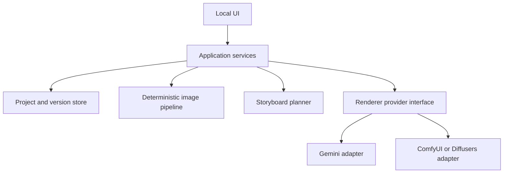

# Sprite Motion Lab — Proposed architecture

## 1. Architectural goals

- Keep creative-model calls replaceable.
- Keep UI code thin and test core behavior without launching a browser.
- Preserve every source asset, frame version, generation request, and export.
- Separate AI uncertainty from deterministic image processing.
- Support local and hosted providers through the same application workflow.
- Remain understandable to one learner and runnable on an Apple M4 Max with 36 GB unified memory.

This is a proposed architecture, not permission to scaffold every component at once.

## 2. Initial stack

| Concern | Initial choice | Notes |
| --- | --- | --- |
| Language | Python 3.11+ | Confirm supported version against chosen ML/UI packages before pinning. |
| UI | Gradio Blocks | First local visual UI; evaluate against timeline/version requirements. |
| Domain models | Python dataclasses or Pydantic | Choose one early and use consistently. Pydantic helps validate persisted/provider data. |
| Metadata | SQLite | Local, durable, inspectable; use migrations once schema stabilizes. |
| Image files | Project-local filesystem | PNG sources, normalized assets, versions, previews, and exports. Store paths and hashes in SQLite. |
| Image processing | Pillow first; OpenCV only when needed | Palette, alpha, crop, resize, sprite sheet, simple geometry. |
| Hosted provider | Official Google Gemini SDK behind adapter | Exact model is configuration, not hard-coded throughout the app. |
| Local workflow prototype | ComfyUI as separate local process | Manual/visual experimentation before code integration. |
| Programmatic local inference | Hugging Face Diffusers later | Only after a useful workflow is proven and hardware-tested. |
| Tests | pytest | Unit tests for ordering, versions, storage, palette, processing, and provider contracts. |

Avoid FastAPI initially unless a separate API boundary becomes necessary. Gradio callbacks should call application services, not contain business logic. Avoid an ORM until raw `sqlite3` or a small data layer becomes burdensome.

## 3. Component boundaries



### UI layer

Displays state and translates user actions into service calls. It must not decide ordering rules, delete versions, construct provider-specific prompts, or manipulate image files directly.

### Application services

Use-case-oriented methods, for example:

- create/open project;
- import canonical sprite;
- propose/approve palette;
- save action request;
- save/select storyboard;
- create frame slot;
- generate key-pose candidates;
- insert/smooth gap;
- create rework version;
- activate version;
- set duration;
- build preview;
- validate/export animation.

### Domain and persistence

Owns durable identities, ordering, immutable versions, active selection, relationships, run status, and transactions. The database is authoritative for metadata; image files are content-addressed or safely named and referenced from it.

### Deterministic image pipeline

Owns decoding, source preservation, alpha/background handling, canvas normalization, nearest-neighbor resizing, palette extraction, quantization, alignment assistance, sheet packing, preview rendering, and measurable validation.

### Model adapters

Translate provider-neutral requests into provider calls. They return raw candidates plus provider metadata; they do not write directly into active frame state.

## 4. Data model

Names may change during implementation, but these concepts must remain.

| Entity | Important fields and behavior |
| --- | --- |
| `Project` | id, name, root path, created/updated time, target width/height, pixel scale, settings version. |
| `Character` | project id, canonical source asset, normalized reference asset, identity notes, approved palette id. |
| `Palette` | ordered colors, transparency rule, extraction method, approval status, version. Preserve earlier approved palettes if changed. |
| `ReferenceAsset` | source path, normalized path, role, SHA-256, dimensions, provenance/license notes. |
| `Animation` | project id, name, complete action, personality, pace, start/end, loop mode, constraints, chosen storyboard id. |
| `Storyboard` | planner run, proposal label, summary, ordered beats, timing suggestions, selected status. |
| `FrameSlot` | animation id, stable id, ordering key, role metadata, active version id, hold duration, notes. |
| `FrameVersion` | immutable id, frame slot id, image asset, parent version id, generation run id, purpose, instruction, validation result, created time. |
| `Transition` | derived or stored relation between adjacent slots; review status, warning summary, last previewed versions. |
| `GenerationRun` | purpose, provider, model, request payload snapshot, input asset ids/hashes, seed/settings, status, output ids, timing, estimated/actual cost, error. |
| `Export` | animation state snapshot, output paths/hashes, layout, metadata format, created time. |

### Why slot and version are separate

The frame slot owns timeline position and duration. Versions own candidate pixels. Switching a version must not change the slot's place or timing. Reworking adds a version rather than a new timeline position.

### Version branching

`parent_version_id` permits:

```text
V1
├── V2 (creative alternative)
│   └── V4 (lower front paws)
└── V3 (stronger expression)
```

There is exactly one active version per populated frame slot, but any retained version can become a new branch parent.

## 5. Ordering and midpoint insertion

The timeline must support insertion between any adjacent frames without renumbering user-visible identities destructively.

Reasonable internal approaches:

- integer positions with controlled renumbering inside one database transaction;
- fractional/rational ordering keys;
- lexicographically sortable position identifiers.

Start with the simplest well-tested option. User-visible frame numbers should be computed from current order, not used as permanent database identities.

When smoothing gap A→B:

1. validate that A and B are currently adjacent;
2. snapshot their active version ids;
3. create a generation run referencing both;
4. create a new frame slot at the midpoint only when there is a candidate to retain;
5. attach all returned candidates as versions of that slot;
6. select an active version only through an explicit owner choice or clearly configured default;
7. create/refresh the two new transitions;
8. leave original endpoints and versions untouched.

If the active version of an endpoint changes while a request is running, do not silently treat the output as based on the new endpoint. Preserve the exact input-version provenance and warn before activation.

## 6. Provider-neutral request contracts

### Storyboard planning request

Inputs:

- complete action fields;
- character description and constraints;
- target animation style/canvas;
- requested proposal count;
- optional owner feedback on prior proposals.

Output must be structured data, validated before persistence: proposal label, summary, beats, pose descriptions, relative timing, loop notes, and risks.

### Image-render request

Inputs may include:

- purpose: key pose, in-between, rework, or local experiment;
- complete action context;
- selected beat and frame role;
- canonical reference and approved palette reference;
- base version for rework;
- active left and right endpoint images;
- relative progress `t` between endpoints, such as `0.5`;
- optional owner instruction;
- invariant constraints;
- target output/candidate count;
- provider options.

Output:

- one or more raw image candidates;
- provider request/response identifiers where safe;
- seed or reproducibility metadata when available;
- token/image usage and cost metadata when available;
- warnings and finish reason.

Provider responses are untrusted data. Validate content type, dimensions, size, and decoding before adding an image asset.

## 7. Image-processing pipeline

Process each raw candidate non-destructively:

1. **Preserve raw output** with provider metadata and hash.
2. **Decode and validate** file type, dimensions, and alpha/background.
3. **Identify artwork bounds** while guarding against borders, shadows, and stray pixels.
4. **Normalize orientation/canvas** using project settings and endpoint context.
5. **Remove or mask background** only through an explicit deterministic step; retain the raw image.
6. **Resize** with an intentional method. Pixel-art enlargement uses nearest neighbor. Model output may need a carefully evaluated downscaling/quantization route rather than blind resampling.
7. **Map to approved palette** and save both pre-quantized and quantized candidates when comparison is useful.
8. **Align** according to configurable anchors such as ground line, body center, or owner-provided point.
9. **Validate** and record warnings.
10. **Create preview derivative** and wait for owner selection.

Never assume a white background is transparent. Never save JPEG as a final sprite format.

## 8. Palette workflow

Normal code, not the model, is authoritative.

1. Extract prominent nontransparent colors from the canonical sprite.
2. Present them with counts and transparent/background classification.
3. Let the owner edit and approve.
4. Save an ordered exact RGB/RGBA palette.
5. Provide the palette visually and textually to the renderer when supported.
6. Quantize results to exact approved colors as a reviewable derivative.
7. Report per-color mapping and out-of-palette percentage.

Do not quantize the only copy of an image.

## 9. Transition validation

Deterministic checks can flag, not solve, likely problems:

- canvas/dimension mismatch;
- palette violations;
- foreground bounding-box scale jump;
- centroid and ground-contact displacement;
- sudden silhouette-area change;
- edge/silhouette difference;
- prop location/size change;
- alpha/background inconsistency;
- perceptual embedding distance, if later justified.

Optical flow may be explored later, but pixel sprites and large pose changes can make it misleading. The animation preview and owner judgment remain authoritative.

## 10. Project directory proposal

Do not create all modules until their phase is approved. The eventual structure may resemble:

```text
AGENTS.md
docs/
src/sprite_motion_lab/
  app/              # use-case services
  domain/           # validated models and rules
  persistence/      # SQLite and file repository
  image_ops/        # deterministic processing
  providers/        # planner/renderer adapters
  ui/               # Gradio composition and callbacks
tests/
project_data/       # ignored local projects, never committed
```

## 11. Testing strategy

### Unit tests

- palette extraction/serialization;
- nearest-neighbor canvas operations;
- version immutability and branching;
- active-version switching;
- adjacent-gap lookup and midpoint insertion;
- transition invalidation after version changes;
- cost estimation;
- provider request construction with fake adapters;
- export layout and metadata.

### Integration tests

- create/save/reopen project;
- generation success/failure using a fake provider;
- rework an older version and preserve branches;
- repeatedly subdivide a gap;
- export and verify hashes/dimensions/transparency;
- cancel/retry a run without data loss.

### Golden assets

Use small, owner-created or clearly licensed test sprites committed under an explicit license. Avoid committing private API outputs or internet examples of unclear origin.

### Model evaluation

Model tests are experiments, not ordinary deterministic CI. Save the exact configuration, references, outputs, owner ratings, latency, and estimated cost in the experiment log.

## 12. Security, privacy, and cost

- API keys live in ignored environment files or OS credential storage, never SQLite/project exports.
- Logs redact authorization headers and avoid image bytes.
- Hosted calls require an explicit confirmation containing provider, model, candidate count, uploaded references, and estimated maximum cost.
- Project data is local unless the owner explicitly invokes a hosted provider.
- ComfyUI should bind locally unless the owner intentionally configures otherwise.
- Do not execute arbitrary ComfyUI workflows or load untrusted checkpoints without review; model files and custom nodes can carry supply-chain risk.
