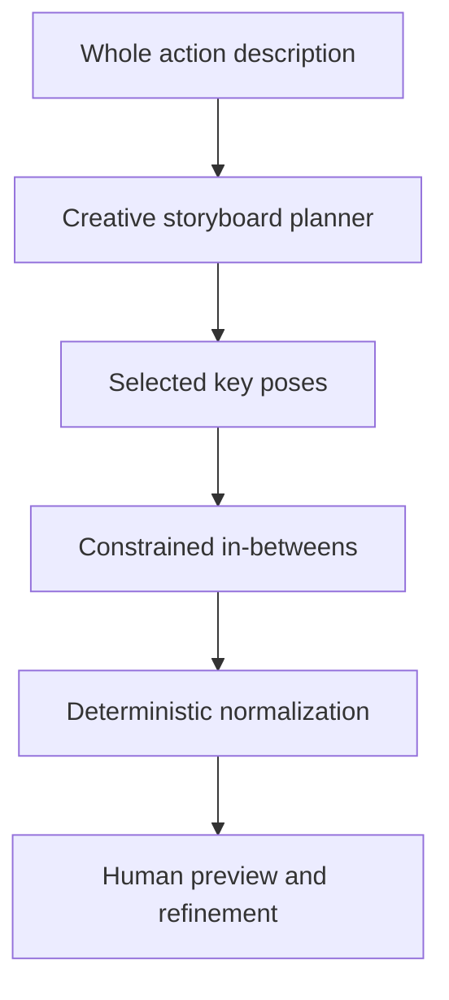

# Sprite Motion Lab — Model and generation strategy

## 1. Core strategy

Do not ask one image model to invent the entire sprite sheet in one unconstrained call. Separate planning, rendering, continuity, and deterministic cleanup.



The planner may be a text-capable model. The renderer is an image generation/editing model. Normal Python code owns files, palettes, ordering, validation, previews, and exports.

## 2. Responsibility split

### Owner provides or approves

- canonical character sprite;
- exact target canvas and approved palette;
- complete action description;
- optional personality, pace, start/end, loop, prop, and constraints;
- selected storyboard concept;
- active frame versions and subjective continuity judgment;
- optional rework instructions.

### Deterministic code decides

- palette extraction candidates and exact stored colors;
- project/image identities and hashes;
- frame ordering, adjacency, insertion, and durations;
- version branching and active selection;
- provider request assembly and cost calculation;
- canvas/transparency checks;
- crop, alignment assistance, palette mapping, preview, and export;
- warnings and provenance.

### AI proposes

- storyboard alternatives and motion beats;
- creative staging, expression, silhouette, and pose;
- key-pose image candidates;
- intermediate anatomy between known endpoints;
- creative or guided rework candidates;
- optional recommendation that a transition needs more drawings.

The AI never silently activates, deletes, or overwrites a frame.

## 3. Prompt/context contracts

### Storyboard planner

The planner should receive the complete action once and return structured alternatives. It should be asked to think in animation beats and readable silhouettes without requiring the owner to specify individual limb movement.

Required output per proposal:

- title and concept;
- start, anticipation, primary action, reaction, and settle beats as applicable;
- pose description for each important drawing;
- relative timing/holds;
- loop advice;
- risks or continuity notes.

Do not force every action into the same number of beats.

### Key pose

Context includes:

- whole action and selected storyboard;
- specific beat/pose role;
- canonical character and identity constraints;
- approved palette reference;
- target side/view direction, canvas, and ground line;
- previous selected pose when useful;
- prop references and invariants;
- negative constraints against extra limbs, changed markings, perspective drift, text, borders, and backgrounds.

### In-between

An in-between request includes both endpoint images and says where the new pose lies between them, such as halfway or one-third through. It also includes the whole action so the model understands intent rather than merely averaging pixels.

Conceptually:

```text
Create the character at t=0.5 between the supplied left and right poses.
Preserve identity, viewing angle, scale, palette intent, ground line, prop,
and direction of motion. This is the anticipation-to-launch transition in the
larger pounce action described below. Invent a plausible intermediate pose;
do not create a blended/ghosted image.
```

If a generated in-between becomes an endpoint later, send its exact active image like any original key pose.

### Rework

Rework uses a base version, active neighbors, whole-action context, and optional instruction. If the instruction is blank, request a meaningfully different but transition-compatible creative alternative. If populated, follow it while treating listed invariants as fixed.

## 4. Hosted starting path: Gemini/Nano Banana

Why start here:

- the owner already obtained appealing creative poses from Nano Banana;
- reference-image conversational editing is suitable for iterative rework;
- no local model installation is required for the first model experiment;
- cost is pay-per-generation rather than a forgotten subscription.

Use the official Gemini API directly unless a future supported platform route is documented. **Nano Banana is not the same as Amazon Bedrock's Nova Canvas or Titan Image Generator.** Do not label a Bedrock model as Nano Banana.

Implementation rules:

- isolate the official SDK inside one adapter;
- keep model id configurable;
- save exact request settings, input hashes, response metadata, and usage;
- show uploaded references and estimated cost before the call;
- begin with one or a few candidates, not a large batch;
- generate at a supported larger resolution, then create reviewed pixel derivatives;
- verify current API docs, model lifecycle, pricing, data-use settings, and commercial terms before implementation.

### Cost planning snapshot

As researched on 2026-11-03, official Gemini Developer API pricing listed approximately:

- Nano Banana 2.1 1K output: **$0.0336 per generated image**;
- Gemini 3.1 Flash Image / Nano Banana 2 1K output: **$0.067 per image**;
- Nano Banana Pro 1K/2K output: **$0.134 per image**.

Inputs add a smaller usage charge. Treat these only as planning values and verify immediately before use: <https://ai.google.dev/gemini-api/docs/pricing>.

The UI estimates **attempt cost**, not merely final-frame cost. Three candidates cost roughly three image outputs. Storyboards, failed attempts, reworks, and in-betweens all count.

## 5. Local/open model path

The goal is not to prove that local models are free. The goal is to understand and control the image pipeline, reduce long-term provider dependence, and learn CV/generative tooling.

### SDXL first

Start local structural-control experiments with SDXL because it has a mature ecosystem of:

- IP-Adapter checkpoints;
- ControlNet variants;
- pixel-art/style LoRAs;
- Diffusers examples;
- community workflows and lower-friction experimentation.

SDXL is older and may follow complex creative instructions less well than newer models, but it is a practical platform for learning how appearance and pose controls interact.

### FLUX second

FLUX models are generally strong at prompt interpretation and image quality, and Diffusers documents FLUX pipelines and IP-Adapter support. They can be substantially heavier, and compatible controls/checkpoints vary by exact FLUX version and license. Test one hardware-appropriate variant after the SDXL control pipeline is understood.

Do not assume a workflow/checkpoint built for SDXL is compatible with FLUX.

### IP-Adapter

IP-Adapter conditions generation on one or more reference images. Its role here is to encourage character appearance, markings, proportions, palette/style, or prop identity.

It is not a temporal-animation system and does not guarantee exact identity. Adapter strength must be tuned: too low permits drift; too high can copy the reference pose and resist movement.

### ControlNet

ControlNet conditions generation on structure such as edges, depth, segmentation, or pose. Its role here is to constrain body layout and the transition path.

Human OpenPose is not an ideal default for a quadruped cat. Explore, in order:

1. rough owner-edited silhouette or mass drawing;
2. edge/canny guide from a draft pose;
3. manually placed cat landmarks or a simple skeleton;
4. segmentation/depth if it provides measurable value;
5. specialized animal pose tooling only if licensing and integration are reasonable.

### Combining IP-Adapter and ControlNet

This is a valid experimental direction:

- IP-Adapter says approximately **what the cat should look like**;
- ControlNet says approximately **where its body should be**;
- the text prompt says **what the action means**.

The controls can conflict. Record adapter scales, ControlNet strength, denoising strength, seed, prompt, and output for every comparison. More controls do not automatically mean more continuity.

Official starting references:

- IP-Adapter: <https://huggingface.co/docs/diffusers/main/using-diffusers/ip_adapter>
- ControlNet: <https://huggingface.co/docs/diffusers/main/using-diffusers/controlnet>
- FLUX pipelines: <https://huggingface.co/docs/diffusers/main/api/pipelines/flux>

## 6. ComfyUI versus Diffusers

### ComfyUI

ComfyUI is a visual node graph for loading a model, connecting prompts and reference/control inputs, sampling, and post-processing. Use it as the **laboratory** for the first SDXL/FLUX experiments because the owner can see the data flow and change one control at a time.

Benefits:

- fast workflow experimentation;
- visual understanding of components;
- easy parameter comparisons;
- reusable saved workflow JSON.

Costs:

- custom-node and checkpoint compatibility issues;
- workflows can become difficult to version and automate;
- untrusted custom nodes/checkpoints are a supply-chain risk;
- calling ComfyUI as a service adds another process.

### Diffusers

Diffusers is a Python library for building programmatic image-generation pipelines. Move a proven ComfyUI workflow into Diffusers when:

- the exact model and controls produce useful results;
- the owner wants generation from the Sprite Motion Lab UI;
- required components are supported in Python;
- hardware use and licenses are understood.

Do not build both integrations simultaneously. A first local adapter may call a local ComfyUI workflow through its API; a later Diffusers adapter can replace it without changing domain/UI logic.

## 7. Ollama

Ollama image generation may be tested as a simple local provider for supported FLUX-family or other image models. It is convenient for inference but is not the preferred environment for detailed IP-Adapter/ControlNet composition or training. Keep it optional rather than designing the system around it.

## 8. Fine-tuning and LoRA policy

Fine-tuning is not necessary for the first useful product.

Try these first:

1. canonical image references;
2. stronger prompt/context contracts;
3. endpoint-conditioned generation;
4. IP-Adapter for appearance;
5. ControlNet or simple pose guides;
6. deterministic palette/alignment processing;
7. measured provider/model comparisons.

Consider an identity/style LoRA only when:

- repeated tests show persistent character drift;
- a clean, diverse, owner-created or explicitly licensed dataset exists;
- the target base model has stable licensing and tooling;
- success metrics and a held-out evaluation set are defined;
- the owner approves the time, storage, compute, and cost.

A LoRA may teach character appearance or pixel-art style. It does **not** teach temporal motion by itself. Training a pose/animation ControlNet requires a substantially larger paired structure-to-image dataset and is a far-later research project.

Do not train on:

- internet sprites of unclear ownership;
- PixelLab outputs if its terms prohibit training use;
- hosted-provider outputs whose terms do not explicitly allow it;
- private user assets without explicit approval.

## 9. Pixel-art output strategy

Most foundation models do not natively reason in exact 32×32 or 64×64 pixels. Generate at a supported larger resolution with intentionally enlarged pixel-art references, then evaluate a controlled conversion:

- crop artwork region;
- remove background;
- align to target coordinate system;
- downscale using tested methods;
- quantize to the approved palette;
- remove isolated artifacts where rules are safe;
- preserve raw and intermediate files;
- compare before activating.

Do not assume that asking for “64×64 pixel art” yields an exact production sprite.

## 10. Evaluation framework

For a fixed short test action and canonical character, compare providers/configurations on:

- owner-rated creativity;
- identity/marking consistency;
- pose instruction adherence;
- endpoint continuity;
- prop consistency;
- silhouette readability at final size;
- palette conversion quality;
- anatomy/artifact failures;
- number of attempts needed;
- latency;
- hosted cost or local memory/time;
- licensing and integration friction.

Save contact sheets, animation previews, configuration, and ratings. Avoid declaring a winner from one attractive image.

## 11. Recommended experiment order

1. Prove deterministic import/palette/preview/version/export with no model.
2. Use fake provider outputs to prove key-pose, rework, and gap-smoothing state transitions.
3. Run a small Nano Banana key-pose experiment.
4. Run endpoint-conditioned in-between and rework experiments.
5. Tune prompt/context assembly and post-processing.
6. Install and learn ComfyUI only after owner approval.
7. Test one licensed SDXL + IP-Adapter workflow.
8. Add a structural guide/ControlNet and compare.
9. Test one hardware-appropriate FLUX workflow.
10. Integrate the best local workflow through ComfyUI API or Diffusers.
11. Reconsider LoRA only with evidence and a licensed dataset.
