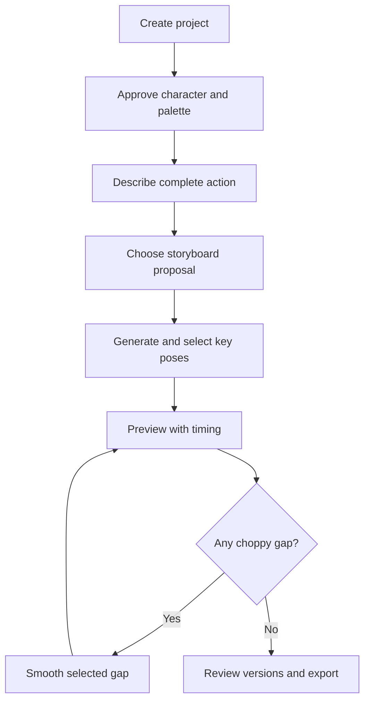

# Sprite Motion Lab — Product specification

## 1. Purpose

Sprite Motion Lab is a local creative tool that helps a non-animator turn a natural-language action into a coherent pixel-art animation while retaining control over the character, palette, continuity, timing, and revisions.

The first practical use is producing animations for the pixel cat in the Thread Cat macOS application. The tool should not be coupled to Thread Cat, Swift, or cats; it should later accept other approved sprites and export ordinary PNG sequences and sprite sheets.

The product exists because a general image model can invent appealing poses but tends to produce a **collection of illustrations rather than animation frames**. Across generated images, anatomy, proportions, perspective, markings, tail position, object position, scale, palette, and ground contact can drift. Sprite Motion Lab wraps creative generation in a controlled planning, continuity, versioning, validation, and export process.

## 2. Owner needs

The owner:

- can describe the complete action and desired personality;
- wants the model to take creative liberties rather than requiring exact per-frame art direction;
- may not know how many key poses or in-between frames an action needs;
- wants to add frames progressively wherever playback remains choppy;
- may accept a frame now and rework or replace it later;
- wants every generated alternative retained for later comparison;
- may sometimes have a precise rework instruction and sometimes want a creative alternative;
- wants a visual UI rather than managing files and prompts manually;
- is learning computer vision and generative-image workflows, so the implementation must remain understandable;
- wants a reusable personal tool without depending permanently on a subscription.

## 3. Product principles

### Creativity first, then continuity

Generation is split conceptually into two passes:

1. **Creative planning and key poses:** propose appealing ways to stage the complete action.
2. **Continuity and in-betweens:** connect selected poses while strongly constraining identity, movement direction, and neighboring endpoints.

The continuity stage must not eliminate personality. It should constrain *where the motion is going* while allowing the renderer to solve the intermediate anatomy.

### User selects; the system preserves

The system may recommend storyboards, timing, and extra frames, but the owner chooses the active result. No approved or rejected image is destroyed automatically.

### Frame count is discovered

The owner should not need to enter “eight frames.” A planner proposes beats and timing, and the owner can recursively smooth individual gaps. Unique drawings and playback duration are independent.

### AI proposes pixels; code enforces invariants

AI handles interpretation, staging, pose invention, expression, and rendering. Normal code handles storage, ordering, versioning, canvas size, transparency, palette enforcement, alignment, validation, preview, and export.

## 4. Primary workflow



### Project setup

The owner provides:

- an approved canonical character sprite, preferably a transparent PNG;
- target canvas dimensions, initially defaulting to 64×64 but configurable;
- an approved palette, either supplied directly or extracted by code and then reviewed;
- optional visual references for style or an object such as a yarn ball;
- project/export name.

Internet examples may be used only for private visual study when their rights are unclear. They must not be redistributed, included in a public repository, or used for training without permission.

### Action request

The minimum useful request is a complete action description. Optional controls include personality, energy/speed, start state, ending state, loop behavior, required props, and constraints.

Example:

```text
Action: The cat discovers a ball of yarn, crouches, pounces, becomes tangled,
and finishes sitting proudly as if everything went according to plan.
Personality: playful, slightly clumsy, dramatic
Speed: quick and energetic
Loop: no; end sitting
Required prop: blue yarn ball
```

### Storyboard planning

The planner should return two or three meaningfully different proposals. Each proposal contains:

- a short concept label;
- emotional and physical arc;
- ordered motion beats/key poses;
- suggested relative timing and holds;
- whether it loops cleanly;
- risks such as a difficult turn or major perspective change.

The owner chooses or edits a proposal at the **beat level**, not by specifying every paw.

### Key-pose generation

For each chosen beat, the renderer receives the complete action context, canonical character, palette reference, pose description, previous approved pose when available, and relevant prop references. Multiple candidates may be generated. The owner selects an active candidate but retains all versions.

### Adaptive continuity

Every adjacent pair forms a selectable gap. “Smooth this gap” uses both active endpoint images, the overall action, relative progress, and continuity constraints. The inserted image becomes an ordinary frame and can itself become an endpoint for later smoothing.

If a gap remains choppy, it can be subdivided again. A future automatic recommendation may estimate whether a gap needs one, two, or three new frames, but user-directed recursive insertion is sufficient for the first product.

### Rework and version selection

Reworking creates a new version of the same timeline slot. The owner may provide an optional instruction such as “lower the front paws” or leave it blank for a creative alternative. A version can be based on the active image or any older version. The owner can switch the active version at any time.

### Timing and export

Each active frame has a hold duration or playback tick count. Preview uses nearest-neighbor rendering so pixels remain crisp. Export supports:

- transparent PNG sequence;
- packed sprite sheet with metadata;
- animated GIF for convenient preview only;
- a project manifest containing frame order, durations, dimensions, palette, and provenance.

## 5. MVP scope

The first useful product should support:

- local project creation and reopening;
- canonical PNG import;
- candidate palette extraction and owner approval;
- editable overall animation description;
- one hosted model adapter after explicit owner approval;
- storyboard/key-pose proposal storage;
- ordered frame timeline;
- version history with active-version selection;
- optional rework instruction and creative rework;
- insertion between any adjacent frames;
- recursive gap smoothing;
- per-frame timing;
- deterministic normalization, palette quantization, alignment assistance, preview, and export;
- generation history sufficient to reproduce or understand each attempt.

## 6. Explicit non-goals for the MVP

- training a foundation model;
- building a PixelLab replacement or public SaaS;
- automatic perfect animation from a single prompt;
- a needy virtual-pet system;
- generating the Thread Cat macOS application itself;
- real-time collaboration, accounts, billing, or cloud storage;
- mobile support;
- 3D animation or vector rigging;
- automatic LoRA training;
- one-click publishing of unreviewed AI assets;
- a sophisticated React timeline before the local workflow is proven.

## 7. Constraints and quality requirements

- Local-first and private by default.
- Hosted providers are optional adapters, not architectural dependencies.
- Paid calls require explicit approval and a cost estimate.
- Original imported assets and all generated versions remain recoverable.
- Pixel operations must use nearest-neighbor scaling where appropriate; avoid unintended antialiasing.
- Exports must use exact canvas dimensions and predictable transparent backgrounds.
- Palette changes must be visible and reversible.
- Every provider/model/checkpoint/reference asset must have recorded provenance and reviewed usage terms.
- The tool may report automated warnings, but visual playback and owner judgment are the final continuity test.

## 8. Success criteria

### First vertical slice

The owner can create a local project, import a canonical cat, approve an extracted palette, add several placeholder frames, adjust their durations, preview them, and export a valid sprite sheet without any AI provider.

### Hosted-model milestone

The owner can describe one short action, choose a storyboard, generate/select key poses, smooth at least one selected gap, rework a frame with and without guidance, switch between saved versions, and export the chosen sequence.

### Local-model milestone

The same project and UI can route an experimental generation through a documented SDXL or FLUX workflow without changing the timeline/version model. Results can be compared against the hosted provider using the same evaluation checklist.

## 9. Terminology

| Term | Meaning |
| --- | --- |
| Canonical character | Owner-approved reference defining identity, markings, proportions, and style. |
| Palette | Approved finite color set for final sprites. |
| Animation | One complete action with global description and timing. |
| Frame slot | A position in the timeline. It can be marked as a key pose or in-between. |
| Frame version | One immutable candidate image for a frame slot. |
| Active version | The version currently used for preview and export. |
| Gap | Transition between two adjacent active frame slots. |
| Smooth gap | Generate and insert one or more frames between the selected endpoints. |
| Hold duration | Playback time for a frame; not another generated drawing. |
| Generation run | Recorded provider request, inputs, configuration, outputs, status, and cost estimate. |

## 10. Relationship to Thread Cat

Thread Cat remains a separate native macOS project. Sprite Motion Lab produces reusable art assets that Thread Cat can consume. Do not couple this tool to SwiftUI, global shortcuts, task storage, the Thread/Compost product model, or Thread Cat's release schedule.
