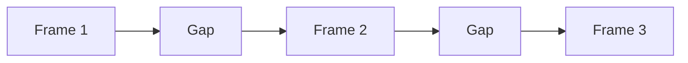

# Sprite Motion Lab — UX and workflows

## 1. UX goal

The interface should let the owner direct an animation using ordinary creative language and visual choices. It must not require animation terminology, a predetermined frame count, or manual prompt/file management.

The first interface should be a local Gradio app. It may be visually simple, but the underlying operations must match the intended product. If Gradio makes timeline interactions unreasonably awkward, record the evidence in `DECISIONS.md` before moving to a custom web frontend.

## 2. Main workspace

The workspace has five conceptual regions:

1. **Project/character panel:** canonical sprite, canvas size, approved palette, prop references, save state.
2. **Action panel:** complete action description plus personality, speed, loop, and constraints.
3. **Preview:** playback at adjustable zoom using nearest-neighbor rendering.
4. **Timeline:** ordered frame thumbnails, duration labels, selected gaps, status badges, and active-version indicators.
5. **Inspector:** frame versions, rework controls, generation details, validation warnings, and export actions.

The first Gradio version can arrange these as tabs or stacked sections. Drag-and-drop ordering is optional initially; explicit move-left/move-right controls are acceptable if reliable.

## 3. New-animation workflow

### Step A — Character setup

The user:

1. imports a transparent canonical sprite;
2. chooses target canvas size;
3. sees code-extracted palette candidates with counts;
4. removes, merges, or adds colors if needed;
5. approves and saves the palette;
6. optionally imports prop/style references.

The UI must clearly distinguish the original source image from the normalized project copy. Never alter the source file.

### Step B — Describe the complete motion

Required field:

- **What happens?** Free text describing the complete action.

Optional fields:

- personality or emotion;
- pace/energy;
- starting pose;
- ending pose;
- loop: yes, no, or “suggest”; 
- required props;
- visual constraints and things to avoid.

The complete description is durable project data. It is sent to later key-pose, in-between, and rework generations so each isolated request retains the larger intent.

### Step C — Choose a storyboard

The planner returns two or three cards. A card should show:

- concept title and one-sentence summary;
- ordered beat list;
- suggested key poses;
- relative timing/holds;
- loop note;
- optional difficulty warning.

Actions:

- **Choose this plan**
- **Edit beats**
- **Regenerate proposals** with optional feedback

Choosing a plan must not immediately generate every pose. The owner proceeds one small generation batch at a time.

## 4. Timeline semantics

Every visible thumbnail represents a **frame slot**. Every space between adjacent slots represents a **gap**.



The timeline visually distinguishes:

- key-pose marker;
- ordinary/in-between marker;
- active version number;
- duration/hold;
- validation warnings;
- adjacent transition status: unreviewed, needs preview, acceptable, or choppy.

Key-pose status is editable metadata. A generated in-between may be promoted to a key pose; a former key pose may remain in the timeline without special treatment.

## 5. Adaptive smoothing

### User-facing behavior

The owner selects a gap and chooses **Smooth this gap**. The app:

1. identifies the active left and right versions;
2. shows the overall motion context and an optional instruction box;
3. estimates the request cost before a hosted call;
4. generates an intermediate candidate or a small recommended batch;
5. inserts the chosen result at the temporal midpoint;
6. preserves rejected candidates as versions of the new slot;
7. previews only the affected region and then the full animation.

The inserted frame is now an ordinary endpoint. If either new sub-gap remains choppy, the owner can smooth that sub-gap again.

Example progression:

```text
Crouch → Leap
Crouch → Midpoint A → Leap
Crouch → Midpoint A → Midpoint B → Leap
```

The owner never needs to provide a final frame count.

### Optional future recommendation

The app may later recommend “one more frame likely needed” using motion distance, silhouette/bounding-box change, optical flow, or model judgment. It must present this as a recommendation, not silently generate frames.

## 6. Frame inspection and version history

Selecting a frame opens its inspector.

The inspector shows:

- large active image;
- version gallery with immutable identifiers;
- creation time and parent version;
- provider/model/seed when available;
- generation purpose: key pose, in-between, rework, import, or manual edit;
- prompt/instruction used;
- reference inputs;
- validation results;
- actions: activate, compare, rework, branch from, export single frame, or archive from default view.

### Active versus accepted

Avoid a permanent “finalized” state. **Active** means the version currently used in preview and export. The owner can change it later.

Activating a different version:

- updates preview/export immediately;
- keeps all alternatives;
- marks the left and right transition statuses as **needs preview**;
- does not automatically regenerate neighbors.

### Comparing versions

The owner should be able to:

- view all versions as thumbnails;
- enlarge one;
- compare two side by side;
- rapidly toggle A/B;
- preview the surrounding animation with a temporary candidate before activating it.

Overlay/onion-skin comparison is a useful later enhancement.

## 7. Rework workflow

The owner selects any version—not necessarily the active or newest one—and clicks **Rework**.

The dialog contains:

- optional instruction text;
- base-version indicator;
- automatic context summary;
- candidate count;
- estimated provider cost;
- **Generate rework**;
- **Creative alternative / Surprise me**, equivalent to leaving specific correction guidance empty while retaining context.

Examples of optional guidance:

- “Move the front paws closer to the yarn.”
- “Keep the pose but make the expression proud rather than startled.”
- “Lower the body so this feels more like a crouch.”
- “Make the leap more dramatic without changing the viewing angle.”

Even without guidance, the request includes:

- complete animation description;
- selected storyboard/beat;
- canonical character and palette reference;
- base image;
- active neighbors where present;
- relative position in the transition;
- invariants such as canvas, direction, markings, prop identity, and ground line.

The result becomes a child version of the selected base. Version history may therefore branch; it is not merely a linear undo stack.

## 8. Timing workflow

Each frame slot has a hold duration expressed internally in milliseconds or playback ticks. The UI may expose friendly controls such as:

- short / normal / long hold;
- exact milliseconds in an advanced field;
- duplicate timing from neighbor;
- preview FPS.

Changing timing creates no new image version. The preview should reveal that a six-drawing animation can have more than six playback frames because drawings are held.

The storyboard planner may suggest timing, but the owner can override it.

## 9. Validation and warnings

Warnings should be actionable and non-destructive. Examples:

- non-transparent background detected;
- canvas size differs from project target;
- colors outside approved palette;
- character bounding box jumps unexpectedly;
- ground/contact point shifts;
- left/right orientation changes;
- prop changes color or size;
- likely identity/style drift;
- active version changed and adjacent gap has not been previewed.

The UI should provide **Fix automatically** only for deterministic operations such as canvas normalization or palette mapping. Creative problems should offer rework/smoothing, not silently modify the image.

## 10. Failure and cancellation behavior

- A failed or cancelled generation run remains in history with its error message and no active image.
- Retrying creates another run; it does not rewrite the failure record.
- Partial provider responses are quarantined until validated.
- Closing and reopening the app must not lose a saved project or completed generation.
- Before paid generation, show model, candidate count, and estimated maximum cost.
- Never expose API keys in the UI, logs, project export, or screenshots.

## 11. Export workflow

Before export, show a checklist:

- active version selected for every slot;
- no unresolved missing files;
- target canvas and transparency valid;
- palette enforcement status;
- transition warnings acknowledged;
- frame durations present;
- license/provenance manifest available.

Export is explicit and reproducible. It creates a new export directory rather than overwriting imported source assets or prior exports without confirmation.

## 12. Later UX enhancements

- onion-skin overlays;
- simple silhouette/pose drawing over an existing frame;
- drag-and-drop timeline reordering;
- region masking for localized rework;
- batch candidate comparison;
- automatic gap-quality recommendations;
- A/B comparison of hosted and local providers;
- Aseprite import/export helpers;
- optional manual pixel touch-up handoff, while Aseprite remains the preferred dedicated editor.
